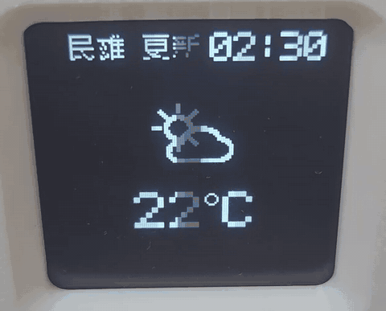

# Weather card

**Original feature:** implemented for this project by the repository owner in the Kira firmware. The weather feature is separate from the Pong standby animation.

This folder is an AI handoff pack for adding a similar live weather card to an existing embedded-device project. Give this folder and the project to an AI coding agent. The included `AI_PROMPT.md` tells the agent to inspect the project, adapt the reference to its existing display and assistant APIs, preserve unrelated features, and build the result.

## Kira reference behavior

- The current Kira reference uses a custom assistant tool named `self.weather.get_current` to retrieve current weather for Minxiong, Taiwan from Open-Meteo over HTTPS.
- The tool returns the same condition, temperature, local update time, and rain information that it displays, so the assistant can use the fetched data in its spoken reply.
- The 128 × 128 monochrome SH1107 OLED card shows a condition icon, temperature in Celsius, location, and Taipei-local update time.
- It also shows the next upcoming hour whose precipitation probability is at least 30%, with its time range and probability.
- Successful responses are cached for 10 minutes. The card is cleared on the next user transcript, with a 60-second timeout as a fallback.
- Network, HTTP, or parsing errors are reported instead of showing guessed or stale weather.

The AI should adapt the layout, drawing calls, tool registration, event scheduling, and timeout behavior to the target project. The Kira implementation is a reference, not a standalone library.

## Preview

The flicker in the GIF comes from recording the display; the screen looks normal when viewed directly.

## Location support for other projects

The current Kira source is fixed to Minxiong, Taiwan. For another project, the AI agent first confirms the country with its owner and saves it as the lookup scope. After setup, the device user can ask for a city or county by name alone; the saved country keeps place lookup in the right country, so the user does not have to repeat the country every time. Taiwan is the Kira example, not a restriction on other projects. The prompt uses Open-Meteo's [Geocoding API](https://open-meteo.com/en/docs/geocoding-api) with a country-code filter. If the owner wants weather requests without a named city, the agent can also confirm a default city during setup.

## Files

- [`AI_PROMPT.md`](AI_PROMPT.md): ready-to-use instructions for an AI coding agent. No fields need to be filled in.
- [`weather_source_excerpt.md`](weather_source_excerpt.md): implementation details and code excerpts from the Kira reference.
- [`preview.gif`](preview.gif): a short recording of the weather card on Kira's OLED.
- [`kira_weather_icons.h`](kira_weather_icons.h): the original 48 × 48 one-bit weather icon set and the small Kira location/update labels. Adapt or redraw them for other display APIs as needed.

## Data source and attribution

Weather data comes from [Open-Meteo](https://open-meteo.com/). The Kira implementation uses Open-Meteo's current conditions and hourly precipitation probability. The location-aware prompt also uses its Geocoding API, which uses GeoNames location data. Include required attribution for Open-Meteo and GeoNames, and review the current [Open-Meteo terms](https://open-meteo.com/en/terms) before commercial use.

## License

The original weather-card implementation and icons do not yet have a separate license. Check back before redistributing or incorporating this source into another project. Open-Meteo's data and service have their own terms and attribution requirements.
